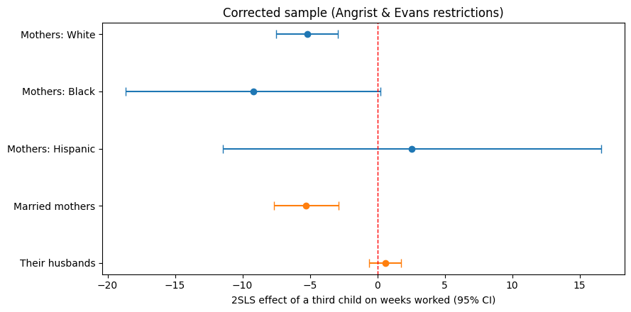

# The Hidden Cost of Parenthood on Women's Careers

Causal Evidence on the Labor Market Impact of Family Size — Replication & Extension of Angrist & Evans (1998)
**Date:** March 2026 · **Corrected:** October 2026 (see [Correction](#correction-october-2026))

---

Having a third child causally reduces a mother's weeks worked by about **5.6 weeks per year** (95% CI: −7.8 to −3.4), roughly a quarter of the 20.8 weeks the average mother in the sample worked. Among married couples, husbands' weeks worked show no detectable change (+0.6 weeks, 95% CI: −0.6 to 1.8). These estimates exactly reproduce the published results of Angrist & Evans (1998).

---

## Methodology

The biggest challenge in measuring the effect of children on careers is that family size is a choice. Women who choose to have more children may differ in ways that also affect their careers. They might be more ambitious, riskier, or have different financial or personal values. If we just compared mothers with two versus three children, the effect of the child would be confounded by these differences.

To solve this, we used an **Instrumental Variables (IV)** design built on a random aspect of family size: the sexes of the first two children. Parents who have two boys or two girls are significantly more likely to have a third child than parents who already have one of each, reflecting a preference for mixed-sex families. Whether the first two children happen to be the same sex is essentially random, so it should have no direct effect on a mother's career.

This instrument is valid because:

1. **Relevance:** same-sex siblings raise the probability of a third child by 6.1 percentage points (first-stage F-statistic on the instrument = 1,675, far above the conventional threshold of 10).
2. **Exclusion:** the sex of the first two children has no plausible direct effect on how many weeks per year a parent works, except through the channel of having an additional child. This is an assumption and cannot be tested directly.

**Sample.** Following the authors' original SAS program, the sample is mothers aged 21–35 with at least two children, whose second child is older than one year, who were at least 15 at their first birth, and whose children's sex and age were recorded rather than imputed by the Census Bureau. This leaves 394,840 mothers out of 927,267 records.

**Specification.** 2SLS regression of weeks worked on `morekids` (more than two children), instrumented by `samesex`. Controls: mother's age, age at first birth, sex of the first and second child, and race indicators. Heteroskedasticity-robust standard errors.

---

## Results

| Estimator | Effect of a third child on mother's weeks worked |
|---|---|
| OLS (biased by selection) | −8.98 (SE 0.07) |
| **IV-2SLS** | **−5.56 (SE 1.12)** |
| Wald estimator (no controls) | −6.36 |

OLS overstates the penalty because mothers who choose a third child differ in ways that also reduce their work; IV uses only the variation in family size that comes from the sex mix of the first two children.

### Figure 1: IV-2SLS Estimates of the Child Penalty on Weeks Worked


*Each dot is the IV-2SLS effect of a third child on annual weeks worked, with a 95% confidence interval. Blue: mothers in the full analysis sample, by race. Orange: the married-couple sample (mothers and their husbands in the same households). The red dashed line marks zero. Data: 1980 U.S. Census extract; Angrist & Evans (1998).*

| Group | N | Effect (weeks) | 95% CI |
|---|---|---|---|
| Mothers: White | 324,693 | −5.19 | −7.48 to −2.90 |
| Mothers: Black | 46,960 | −9.20 | −18.64 to 0.23 |
| Mothers: Hispanic (race code 12) | 11,861 | +2.57 | −11.44 to 16.58 |
| Married mothers | 254,652 | −5.27 | −7.66 to −2.89 |
| Their husbands | 254,652 | +0.58 | −0.60 to 1.76 |

The penalty is clearly negative and statistically significant for White mothers and for married mothers. The estimates for Black and Hispanic mothers are too imprecise to say whether the penalty differs by race: their confidence intervals are wide and overlap the White estimate. Husbands in the same households show no detectable change in weeks worked.

---

## Policy Implications

1. **Parental leave policies are not gender neutral in practice.** Within the same married households, the third child reduces mothers' work by about 5.3 weeks a year while husbands' work does not measurably change. Policies that assume the burden of additional children is shared are misaligned with this evidence.

2. **The career cost is causal, for a specific group.** The IV estimate measures the effect for families who had a third child because their first two were the same sex. Within that group, the reduction in work is caused by the additional child rather than by pre-existing differences between mothers. This supports policies that lower the cost of combining work and larger families, such as subsidized childcare, flexible scheduling, and return-to-work programs.

## Limitations & Next Steps

- **Subgroup precision.** White mothers make up 82% of the sample (324,693). The Black (46,960) and Hispanic (11,861) subsamples are much smaller, and the instrument shifts family size only modestly, so their estimates are too noisy to compare across groups.
- **Race coding.** Race code 12 is treated as Hispanic, following the authors' original program. All codes other than 1 (White), 2 (Black), and 12 are grouped as "other race" in the controls.
- **Who the estimate applies to.** IV identifies a local average treatment effect for families whose fertility responds to the sex of their first two children, not for all families.
- **1980 data.** Women's labor force attachment has changed substantially since 1980. A natural extension is to apply the same design to recent Census or ACS data, where samples are larger and race categories are more detailed.

---

## Correction (October 2026)

The original version of this project (notebooks 02 and 03, March 2026) reported a penalty of −16.6 weeks, about three times the published estimate. The cause was a sample-construction error:

- The analysis used all 927,267 records, including **272,098 one-child households** that have no second child.
- For those households, `samesex = (sexk == sex2nd)` evaluated to false, so they were coded as "not same-sex" alongside families with one boy and one girl.
- Because one-child families have fewer children by definition, the instrument partly measured "has at least two children", which affects weeks worked directly and violates the exclusion restriction.

The warning sign was already in the original notebook: it printed a same-sex share of 0.357 against an expected ~0.505. The corrected notebook (`04_Corrected_Replication.ipynb`) applies the authors' sample restrictions and controls from their original SAS program and reproduces their published sample size and estimates exactly. It also fixes two extension issues: race code 12 was labeled "Other" instead of Hispanic, and the fathers' models used the mothers' age and education as controls.

| | Original (Mar 2026) | Corrected (Oct 2026) | Angrist & Evans (1998) |
|---|---|---|---|
| Sample N | 927,267 | 394,840 | 394,840 |
| Same-sex share | 0.357 | 0.505 | 0.505 |
| First stage (`samesex`) | 0.202 | 0.061 | 0.061 |
| Instrument strength | 23,961 (F for the whole first-stage regression) | 1,675 (F for the instrument alone) | — |
| OLS | not run | −8.98 | −8.98 |
| IV-2SLS (weeks worked) | −16.59 | −5.56 (SE 1.12) | −5.56 (SE 1.12) |
| Wald estimator | −14.58 | −6.36 | — |
| Mothers by race (White / Black / code 12) | −17.47 / −10.63 / −9.88 | −5.19 / −9.20 / +2.57 | — |
| Fathers | +2.07 / +2.05 / +1.19 (by mother's race; CIs for the first two exclude zero) | +0.58, CI −0.60 to 1.76 (married-couple sample) | — |

The original conclusion that White mothers face nearly twice the penalty of other mothers does not hold up, and the father-side result changes from small but statistically significant positive effects to no detectable effect. The original notebooks and figures are kept in the repository for comparison.

---

# Project Overview

## Track
**Track B: The Endogeneity & IV Strategy Track (Instrumental Variables)**

## Paper
Angrist, J. D., & Evans, W. N. (1998). Children and Their Parents' Labor Supply:
Evidence from Exogenous Variation in Family Size.
*American Economic Review*, 88(3), 450–477.

## Causal Question
Does having more children causally reduce parents' labor supply (weeks worked per year)?
Because family size is a choice (endogenous), the authors instrument for it using the sex
composition of the first two children — parents are more likely to have a third child if the
first two are the same sex, a preference unrelated to labor market outcomes.

## Data Source
Downloaded from the Angrist Data Archive at MIT Economics:
https://economics.mit.edu/people/faculty/josh-angrist/angrist-data-archive

The original file (`m_d_806.sas7bdat`, 189.9 MB) is a SAS binary format common in academic economics
research. It was loaded into Python, decoded from byte-string encoding, reduced in memory, and saved
as compressed `.csv.gz` files. See `data/raw/README.md` for full documentation.

## Repository Structure
```
data/
└── raw/
    ├── README.md                            # Data documentation
    ├── census80_slim.csv.gz                 # 20 variables — used by the original notebooks 02 and 03
    ├── census80_full.csv.gz                 # All 85 variables — used by the corrected notebook 04
    └── notebooks/
        ├── 01_Data_Cleaning.ipynb           # SAS ingestion, memory reduction, export to .csv.gz
        ├── 02_Replication_Analysis.ipynb    # Original replication (March 2026, superseded)
        ├── 03_Extention_Analysis.ipynb      # Original race/parent extension (March 2026, superseded)
        ├── 04_Corrected_Replication.ipynb   # Corrected replication and extension (October 2026)
        ├── forest_plot_corrected.png        # Figure 1
        └── forest_plot_*.png.png            # Original figures (superseded)
requirements.txt                             # Python dependencies
README.md                                    # Executive memo and project overview
```

## Reproducing the Analysis
1. Clone this repository.
2. Open `04_Corrected_Replication.ipynb` in Google Colab (badge at the top of the notebook).
3. Upload `data/raw/census80_full.csv.gz` to the Colab session (or point `FILEPATH` to it) and run all cells.
4. Optional: to rebuild the `.csv.gz` files from the original SAS file, download `m_d_806.sas7bdat` from the Angrist Data Archive, place it in `data/raw/`, and run `01_Data_Cleaning.ipynb`.

## AI Tools Acknowledgement
The heterogeneous treatment effects extension in `03_Extention_Analysis.ipynb`, including the IV-2SLS subgroup models by race and gender, the forest plot visualizations, and the written interpretation of results, were developed with the assistance of Claude (Anthropic, claude.ai). Claude was used as a collaborative coding and writing tool to design the interaction model specifications, generate the forest plots, and draft the methods and results documentation. All analytical decisions and interpretations were reviewed and directed by the project author.

The October 2026 correction was developed with Claude (Anthropic, via Claude Code). Claude audited the original notebooks, identified the sample-construction error by comparing them against the authors' original SAS program and output, and supplied the code in `04_Corrected_Replication.ipynb` and a draft of this README. The author ran the corrected notebook, confirmed that it reproduces the published estimates, and reviewed the revised interpretation.

## Environment
- Python 3.12 (Google Colab)
- pandas, numpy, statsmodels, linearmodels, matplotlib (see `requirements.txt`)
